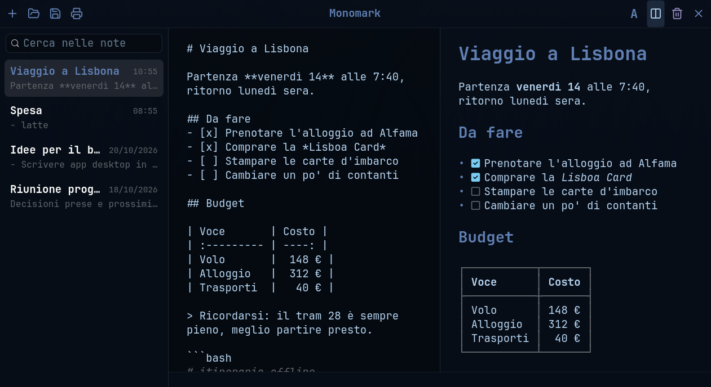

# Monomark

[English](README.md) · **Italiano**

Appunti in Markdown per il desktop Linux, scritti in Go con GTK 4.
Pensato per [Omarchy](https://omarchy.org): segue il tema attivo e ha lo
stesso aspetto del file manager [Strata](https://github.com/lgse/strata).



Ogni nota è un normale file `.md`: niente database e nessun formato
proprietario. Si scrive, e Monomark salva da solo.

## Funzioni

- **Salvataggio automatico** mentre si scrive, in modo sicuro (file
  temporaneo + rinomina), più **Salva** (<kbd>Ctrl</kbd>+<kbd>S</kbd>) per
  scrivere subito il file aperto, senza finestre. Il titolo della nota è la
  sua prima riga.
- **Lista delle note** dalla più recente, con **ricerca** nel testo di tutte
  le note.
- **Anteprima Markdown** affiancata all'editor, con le estensioni GitHub:
  tabelle, barrato, liste di attività e link automatici. Nei blocchi di codice
  la sintassi è colorata, sia nell'anteprima sia nell'editor. Le immagini
  locali (percorso assoluto, `~/`, `file://` o relativo alla nota) vengono
  mostrate e ridotte alla larghezza; quelle in rete non vengono scaricate.
  Viene interpretato anche l'HTML che si usa negli appunti, come su GitHub:
  ``, `<b>`, `<i>`, `<u>`, `<kbd>`, `<mark>`, `<sub>`, `<sup>`,
  `<a>`, `<br>`, `<hr>`, titoli, paragrafi ed elenchi; tag sconosciuti,
  commenti e script vengono nascosti.
- **Menu di formattazione** che mostra accanto a ogni comando il suo
  marcatore Markdown, per impararli strada facendo.
- **Salva con nome** in qualunque cartella, con la finestra di sistema
  (la stessa di Apri). Propone come nome il titolo della nota e chiede
  conferma prima di sostituire un file esistente.
- **Apri** qualsiasi file Markdown o di testo: dal pulsante, trascinandolo
  sulla finestra o da riga di comando (`monomark file.md`). I file aperti
  restano nella lista anche dopo un riavvio.
- **Stampa**, anche in PDF, con colori adatti alla carta, numeri di pagina e
  tabelle allineate.
- **Cestino di sistema** con conferma: una nota cancellata si può recuperare.
  **Togli dalla lista** nasconde una nota senza cancellarne il file;
  riaprendo il file torna in lista.
- **Interfaccia in italiano o in inglese** secondo la lingua del sistema
  (`LANGUAGE`, `LC_ALL`, `LC_MESSAGES`, `LANG`). Con lingue diverse
  dall'italiano si usa l'inglese.
- **Tema dal vivo**: colori del tema Omarchy attivo, carattere JetBrains Mono
  e icone [Lucide](https://lucide.dev) come Strata. Cambiando tema la
  finestra si aggiorna senza riavvio.

Per vedere tutto ciò che l'anteprima sa mostrare, apri
[`esempio.md`](esempio.md) con <kbd>Ctrl</kbd>+<kbd>O</kbd> e premi
<kbd>Ctrl</kbd>+<kbd>E</kbd>.

## Scorciatoie

| Tasti | Azione |
| --- | --- |
| <kbd>Ctrl</kbd>+<kbd>N</kbd> | Nuova nota |
| <kbd>Ctrl</kbd>+<kbd>O</kbd> | Apri un file |
| <kbd>Ctrl</kbd>+<kbd>S</kbd> | Salva subito, nel file della nota |
| <kbd>Ctrl</kbd>+<kbd>Maiusc</kbd>+<kbd>S</kbd> | Salva con nome |
| <kbd>Ctrl</kbd>+<kbd>P</kbd> | Stampa |
| <kbd>Ctrl</kbd>+<kbd>F</kbd> | Cerca nelle note |
| <kbd>Ctrl</kbd>+<kbd>E</kbd> | Mostra o nascondi l'anteprima |
| <kbd>Ctrl</kbd>+<kbd>B</kbd> | Grassetto |
| <kbd>Ctrl</kbd>+<kbd>I</kbd> | Corsivo |
| <kbd>Ctrl</kbd>+<kbd>K</kbd> | Link |
| <kbd>Ctrl</kbd>+<kbd>1</kbd> / <kbd>2</kbd> / <kbd>3</kbd> | Titolo di primo, secondo, terzo livello |
| <kbd>Ctrl</kbd>+<kbd>Z</kbd> | Annulla (anche le formattazioni) |

## Requisiti

- Linux con **GTK 4.10** o successivo
- **Go 1.27** o successivo, con un compilatore C (cgo)
- Il carattere **JetBrains Mono** (su Omarchy è già installato)

Omarchy e Strata non sono obbligatori. Senza Omarchy Monomark usa i colori
di Tokyo Night. Senza le impostazioni di Strata il testo è a 14 px.

Su Arch Linux:

```bash
sudo pacman -S --needed go gtk4 ttf-jetbrains-mono
```

## Compilazione

```bash
git clone https://github.com/zeroviger/monomark.git
cd monomark
go build -o monomark .
./monomark
```

La **prima** compilazione richiede parecchi minuti (circa un quarto d'ora),
perché vanno compilati i binding GTK di [gotk4](https://github.com/diamondburned/gotk4).
Le successive richiedono pochi secondi. Gli avvisi
`conflicting types for built-in function 'free'` vengono da gotk4 e sono
innocui.

I test:

```bash
go test ./...
```

Lanciato da terminale, Monomark stampa solo gli avvisi e gli errori di GTK
che contano: i messaggi informativi (come la scelta del driver Vulkan) e
gli avvisi noti come innocui sono nascosti. Per vedere tutto, per esempio
mentre si cerca un problema:

```bash
G_MESSAGES_DEBUG=all monomark
```

## Installazione

```bash
install -Dm755 monomark ~/.local/bin/monomark
install -Dm644 it.solla.monomark.desktop ~/.local/share/applications/it.solla.monomark.desktop
install -Dm644 it.solla.monomark.svg ~/.local/share/icons/hicolor/scalable/apps/it.solla.monomark.svg
```

Il file `.desktop` aggiunge Monomark al menu delle applicazioni e lo
propone tra i programmi con cui aprire i file Markdown, per esempio da Strata.
L'SVG è l'icona dell'app, usata dal menu; la finestra ce l'ha anche senza
installarla, perché è inclusa nel programma. Come ogni programma Linux, il
file `monomark` in sé non ha un'icona propria nel file manager.

## Dove sono i file

| Cosa | Percorso |
| --- | --- |
| Note | `~/.local/share/monomark/*.md` (rispetta `XDG_DATA_HOME`) |
| Elenco dei file aperti o salvati in altre cartelle | `~/.local/share/monomark/.esterne` |
| Elenco delle note tolte dalla lista (file conservati) | `~/.local/share/monomark/.nascoste` |
| Icone colorate secondo il tema (si rigenerano) | `~/.cache/monomark/icone/` |
| Icona dell'app, per quando non è installata | `~/.cache/monomark/app/` |
| Colori letti dal tema Omarchy | `~/.local/state/omarchy/current/theme/colors.toml` |
| Dimensione del testo letta da Strata | `~/.config/strata/settings.toml`, chiave `text_size` |

Una nota svuotata del tutto viene rimossa dal disco, ma solo se sta nella
cartella delle note: un file aperto da un'altra cartella resta sempre.

## Struttura del codice

| File | Contenuto |
| --- | --- |
| `main.go` | Avvio, finestra, lista, editor, salvataggio automatico, messaggi nel terminale |
| `note.go` | Le note su disco: lettura, salvataggio, spostamento, file esterni |
| `markdown.go` | Conversione Markdown → markup Pango per l'anteprima |
| `formato.go`, `menu.go` | Menu e comandi di formattazione |
| `salva.go` | "Salva con nome" con la finestra di sistema |
| `apri.go` | Apertura di file, trascinamento, file esterni |
| `elimina.go` | Cestino con conferma |
| `html.go` | La parte di HTML interpretata dall'anteprima |
| `immagini.go` | Immagini nell'anteprima: ricerca, riduzione, memoria |
| `stampa.go` | Stampa e impaginazione |
| `tema.go` | CSS, colori del tema Omarchy e ricarica dal vivo |
| `lingua.go` | Lingua del sistema e traduzioni inglesi |
| `icone.go`, `icone/` | Icone Lucide colorate secondo il tema, icona dell'app |
| `it.solla.monomark.svg`, `.desktop` | Icona dell'app e voce nel menu delle applicazioni |

## Ringraziamenti

- [gotk4](https://github.com/diamondburned/gotk4): binding GTK 4 per Go
- [goldmark](https://github.com/yuin/goldmark): parser Markdown
- [Chroma](https://github.com/alecthomas/chroma): colorazione della sintassi
- [Lucide](https://lucide.dev): icone, licenza ISC (vedi `icone/LICENSE`)
- [Strata](https://github.com/lgse/strata), da cui viene lo stile

## Licenza

Copyright © 2026 Giuseppe Solla (zeroviger).

Monomark è software libero: puoi ridistribuirlo e/o modificarlo secondo i
termini della [GNU General Public License](LICENSE) pubblicata dalla Free
Software Foundation, nella versione 3 o (a tua scelta) in una qualunque
versione successiva. È distribuito SENZA ALCUNA GARANZIA; per i dettagli
vedi la licenza.

Le icone Lucide in `icone/` hanno la propria licenza ISC.
