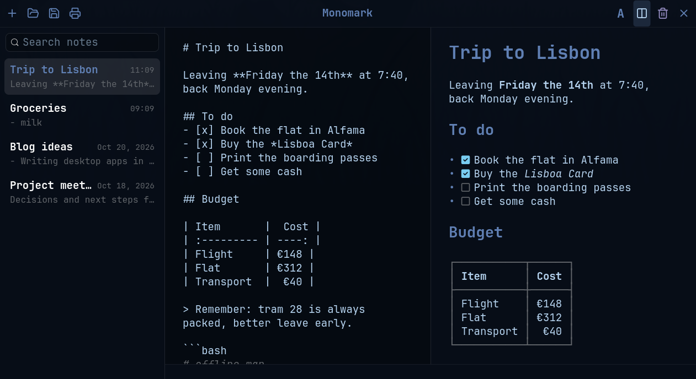

# Monomark

**English** · [Italiano](README.it.md)

Markdown notes for the Linux desktop, written in Go with GTK 4.
Designed for [Omarchy](https://omarchy.org): it follows the active theme and
looks like the [Strata](https://github.com/lgse/strata) file manager.



Every note is a plain `.md` file: no database, no proprietary format.
Just write, and Monomark saves for you.

## Features

- **Autosave** while you type, done safely (temporary file + rename), plus
  **Save** (<kbd>Ctrl</kbd>+<kbd>S</kbd>) to write the open file right away,
  without any dialog. A note's title is its first line.
- **Note list** sorted by most recent, with **full-text search** across all
  notes.
- **Markdown preview** next to the editor, with the GitHub extensions:
  tables, strikethrough, task lists and autolinks. Code blocks are
  syntax-highlighted in both the preview and the editor. Local images
  (absolute paths, `~/`, `file://` or relative to the note) are shown and
  scaled to fit; images on the web are not downloaded. The HTML used in
  notes is understood too, like on GitHub: ``, `<b>`, `<i>`,
  `<u>`, `<kbd>`, `<mark>`, `<sub>`, `<sup>`, `<a>`, `<br>`, `<hr>`,
  headings, paragraphs and lists; unknown tags, comments and scripts are
  hidden.
- **Formatting menu** that shows the Markdown marker next to each command,
  so you learn the syntax along the way.
- **Save as** to any folder, with the system file dialog (the same one as
  Open). The note's title is suggested as the file name, and replacing an
  existing file asks for confirmation.
- **Open** any Markdown or text file: from the button, by dragging it onto
  the window, or from the command line (`monomark file.md`). Opened files
  stay in the list across restarts.
- **Print**, PDF included, with paper-friendly colors, page numbers and
  aligned tables.
- **System trash** with confirmation, so a deleted note can be recovered.
  **Remove from list** hides a note without deleting its file; opening the
  file again brings it back.
- **English or Italian** interface, following the system language
  (`LANGUAGE`, `LC_ALL`, `LC_MESSAGES`, `LANG`). Any language other than
  Italian gets English.
- **Live theming**: colors from the active Omarchy theme, the JetBrains
  Mono font and [Lucide](https://lucide.dev) icons, just like Strata.
  Switching theme updates the window without a restart.

To see everything the preview can show, open [`esempio.md`](esempio.md)
(in Italian) with <kbd>Ctrl</kbd>+<kbd>O</kbd> and press
<kbd>Ctrl</kbd>+<kbd>E</kbd>.

## Keyboard shortcuts

| Keys | Action |
| --- | --- |
| <kbd>Ctrl</kbd>+<kbd>N</kbd> | New note |
| <kbd>Ctrl</kbd>+<kbd>O</kbd> | Open a file |
| <kbd>Ctrl</kbd>+<kbd>S</kbd> | Save now, to the note's own file |
| <kbd>Ctrl</kbd>+<kbd>Shift</kbd>+<kbd>S</kbd> | Save as |
| <kbd>Ctrl</kbd>+<kbd>P</kbd> | Print |
| <kbd>Ctrl</kbd>+<kbd>F</kbd> | Search notes |
| <kbd>Ctrl</kbd>+<kbd>E</kbd> | Show or hide the preview |
| <kbd>Ctrl</kbd>+<kbd>B</kbd> | Bold |
| <kbd>Ctrl</kbd>+<kbd>I</kbd> | Italic |
| <kbd>Ctrl</kbd>+<kbd>K</kbd> | Link |
| <kbd>Ctrl</kbd>+<kbd>1</kbd> / <kbd>2</kbd> / <kbd>3</kbd> | Heading level 1, 2, 3 |
| <kbd>Ctrl</kbd>+<kbd>Z</kbd> | Undo (formatting included) |

## Requirements

- Linux with **GTK 4.10** or newer
- **Go 1.27** or newer, with a C compiler (cgo)
- The **JetBrains Mono** font (already installed on Omarchy)

Omarchy and Strata are optional. Without Omarchy, Monomark uses the Tokyo
Night colors. Without Strata's settings, text is 14 px.

On Arch Linux:

```bash
sudo pacman -S --needed go gtk4 ttf-jetbrains-mono
```

## Building

```bash
git clone https://github.com/zeroviger/monomark.git
cd monomark
go build -o monomark .
./monomark
```

The **first** build takes a while (about a quarter of an hour), because the
GTK bindings of [gotk4](https://github.com/diamondburned/gotk4) have to be
compiled. Later builds take a few seconds. The
`conflicting types for built-in function 'free'` warnings come from gotk4
and are harmless.

Tests:

```bash
go test ./...
```

Launched from a terminal, Monomark prints only the GTK warnings and errors
that matter: informational messages (such as the Vulkan driver choice) and
known harmless warnings are hidden. To see everything, for example while
tracking down a problem:

```bash
G_MESSAGES_DEBUG=all monomark
```

## Installing

```bash
install -Dm755 monomark ~/.local/bin/monomark
install -Dm644 it.solla.monomark.desktop ~/.local/share/applications/it.solla.monomark.desktop
install -Dm644 it.solla.monomark.svg ~/.local/share/icons/hicolor/scalable/apps/it.solla.monomark.svg
```

The `.desktop` file adds Monomark to the application menu and offers it as
an app to open Markdown files with, for example from Strata. The SVG is the
app icon, used by the menu; the window has it even without installing,
because it is also built into the program. Like every Linux program, the
`monomark` file itself has no icon of its own in the file manager.

## Where files live

| What | Path |
| --- | --- |
| Notes | `~/.local/share/monomark/*.md` (honors `XDG_DATA_HOME`) |
| List of files opened or saved in other folders | `~/.local/share/monomark/.esterne` |
| List of notes removed from the list (files kept) | `~/.local/share/monomark/.nascoste` |
| Theme-colored icons (regenerated as needed) | `~/.cache/monomark/icone/` |
| App icon, for when it is not installed | `~/.cache/monomark/app/` |
| Colours read from the Omarchy theme | `~/.local/state/omarchy/current/theme/colors.toml` |
| Text size read from Strata | `~/.config/strata/settings.toml`, key `text_size` |

A note that is emptied completely is removed from disk, but only if it lives
in the notes folder: a file opened from another folder always stays.

## Code layout

The code and its comments are in Italian. Interface strings are written in
Italian and translated by `tr()`; the English translations live in
`lingua.go`, and a test fails if a string has no translation.

| File | Contents |
| --- | --- |
| `main.go` | Startup, window, list, editor, autosave, terminal messages |
| `note.go` | Notes on disk: reading, saving, moving, external files |
| `markdown.go` | Markdown → Pango markup conversion for the preview |
| `formato.go`, `menu.go` | Formatting menu and commands |
| `salva.go` | "Save as" with the system file dialog |
| `apri.go` | Opening files, drag and drop, external files |
| `elimina.go` | Trash with confirmation |
| `html.go` | The HTML subset understood by the preview |
| `immagini.go` | Images in the preview: finding, scaling, caching |
| `stampa.go` | Printing and pagination |
| `tema.go` | CSS, Omarchy theme colors and live reload |
| `lingua.go` | System language detection and English translations |
| `icone.go`, `icone/` | Lucide icons colored by the theme, app icon |
| `it.solla.monomark.svg`, `.desktop` | App icon and application menu entry |

## Credits

- [gotk4](https://github.com/diamondburned/gotk4): GTK 4 bindings for Go
- [goldmark](https://github.com/yuin/goldmark): Markdown parser
- [Chroma](https://github.com/alecthomas/chroma): syntax highlighting
- [Lucide](https://lucide.dev): icons, ISC license (see `icone/LICENSE`)
- [Strata](https://github.com/lgse/strata), which inspired the look

## License

Copyright © 2026 Giuseppe Solla (zeroviger).

Monomark is free software: you can redistribute it and/or modify it under
the terms of the [GNU General Public License](LICENSE) as published by the
Free Software Foundation, either version 3 of the License, or (at your
option) any later version. It is distributed WITHOUT ANY WARRANTY; see the
license for details.

The Lucide icons in `icone/` have their own ISC license.
